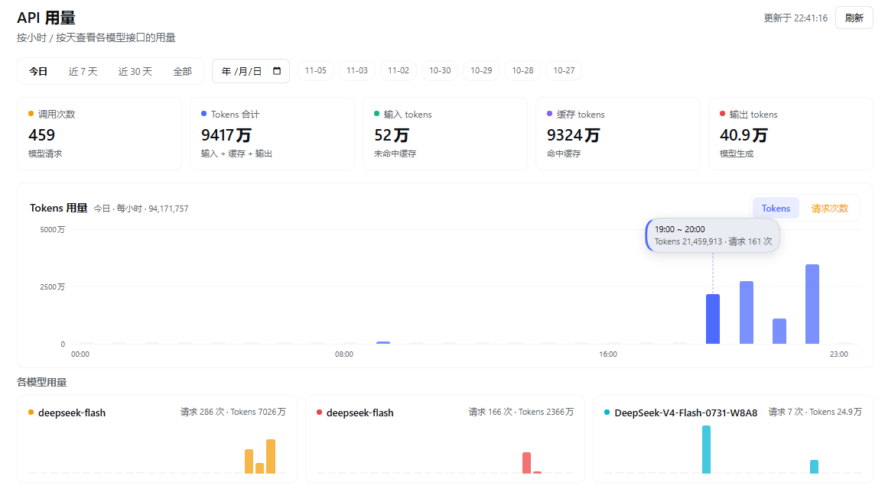

# DSH API Usage Dashboard

DeepSeek Harness（DSH）插件：一个**仪表盘面板**，用来监控本机所有模型 API 的用量——按 provider / 模型拆分，按小时或按天查看调用次数与 token 消耗。

零配置：插件从本地会话日志里读 Harness 实际发出的模型调用，**你新接入的 API 提供方会自动出现**，不需要在这里登记接口地址或密钥。

> A DSH dashboard panel that monitors model API usage per provider and model. Zero configuration: it reads what Harness actually sent from local session logs, so any provider you add later shows up automatically.

<!-- 截图：把图放到 docs/screenshot.png 后取消下一行注释 -->
<!--  -->

## 功能

- **24 小时柱状图**：选「今日」时固定 00:00–23:00 全刻度，没调用的时段留空槽
- **按天钻取**：日期选择器 + 最近 7 天快捷标签，可回看任意一天的小时分布
- **柱状图可交互**：悬停显示虚线定位线与气泡（时间段 / tokens / 请求数），点击钉住柱子对照
- **Tokens / 请求次数** 一键切换，Y 轴自动取整（1/2/5×10ⁿ）并带网格线
- **按模型分组**：每个模型一张 24 小时迷你柱图，模型与 provider 各有固定配色，颜色贯穿卡片、图表与表格
- **指标卡**：调用次数、Tokens 合计、输入、缓存命中、输出
- **明细表**：provider 汇总 + 模型明细，含占比条
- 60 秒自动刷新、中英双语、跟随宿主深浅色主题

## 安装

作为本地目录安装（开发或自用）：

```
plugin_manager install_bundle → 指向本目录的绝对路径
```

发布到 npm 后：

```
plugin_manager install_bundle → dsh-api-usage-dashboard
```

安装后，左侧边栏出现柱状图图标；点开即打开「API 用量」面板。

## 数据来源与隐私

- 数据只来自本机 `~/.dsh/sessions` 下的会话日志，经由 DSH 的 `sessionQuery` 服务读取
- 统计的是会话事件里的 `assistant/message.usage`（`inputTokens` / `outputTokens` / `cacheReadTokens` / `totalTokens`）
- **不读取、不转发任何 API key**；不向任何外部服务发请求
- 只注册一个 loopback（`127.0.0.1`）路由 `/api/dsh-api-usage/summary`，非本机请求返回 403
- 标题生成、网络搜索这类不记 token 的辅助调用单独计数，不计入 token 合计

## 统计口径

| 字段 | 含义 |
| --- | --- |
| 调用次数 | 记录的模型调用条数（含压缩摘要等非对话调用） |
| 输入 tokens | 未命中缓存的输入 token（`inputTokens`） |
| 缓存 tokens | 命中提示缓存的输入 token（`cacheReadTokens`） |
| 输出 tokens | 模型生成的 token（`outputTokens`） |
| 合计 tokens | `totalTokens`，即输入 + 缓存 + 输出 |

同一个 API 提供方下按模型分行；不同 provider 即使模型同名也分开统计。

## 配置

`cordis.patch.yml` 里的 `config` 可调：

```yaml
- insert:
    - id: api-usage-dashboard
      name: 'dsh-api-usage-dashboard'
      config:
        cacheTtlMs: 20000    # 扫描结果缓存毫秒数，0 = 每次请求都重扫
        maxSessions: 0       # 只扫描最近 N 个会话，0 = 全部
        scanConcurrency: 4   # 并发读取会话数（1–8）
```

首次打开会扫描全部会话日志（本机 23 个会话约 1–2 秒），之后走缓存。

## 开发

无构建步骤，宿主半边是 ESM，浏览器半边是 `window.__ModuleLoader__` 注册的纯 JS 模块：

```
index.js          宿主：聚合 + loopback 路由
client.js         浏览器：面板与图表
cordis.patch.yml  Loader 行
locale/{zh,en}.json  插件管理器显示名与描述
icon.svg          插件图标
```

改宿主代码后用 `plugin_manager` 关/开一次插件行即可热重载；改浏览器代码刷新页面。

## 已知限制

- 只统计经 DSH 发出的模型调用；绕过 Harness 直接调的第三方请求看不到
- 金额（¥）尚未支持：需要每个 provider 的单价，其中自建网关通常不公开牌价
- 数据系列使用固定色板（蓝 `#4d6bfe` = Tokens，琥珀 `#f59e0b` = 请求，其余按 provider/模型循环取色），不跟随宿主的强调色；界面其余部分仍走宿主主题 token

## 许可证

[MIT](LICENSE)
